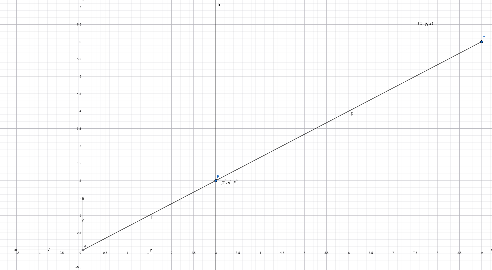

# Transformation Cont. 视图变换

## 三维齐次坐标下变换的矩阵

### Scale

$$
S(s_x,s_y,s_z)=\begin{bmatrix}
    s_x&0&0&0\\0&s_y&0&0\\0&0&s_z&0\\0&0&0&1
\end{bmatrix}
$$

### Translation

$$
T(t_x,t_y,t_z)=\begin{bmatrix}
    1&0&0&t_x\\0&1&0&t_y\\0&0&1&t_z\\0&0&0&1
\end{bmatrix}
$$

### Rotation

$$
R_x(\alpha) = \begin{bmatrix}
    1&0&0&0\\0&cos\alpha&-sin\alpha&0\\0&sin\alpha&cos\alpha&0\\0&0&0&1
\end{bmatrix}
$$

$$
R_y(\alpha) = \begin{bmatrix}
    cos\alpha&0&sin\alpha&0\\0&1&0&0\\-sin\alpha&0&cos\alpha&0\\0&0&0&1
\end{bmatrix}
$$

> 由于指定了z轴方向为$z=x\times y$，因此$x\times z=-y$

$$
R_z(\alpha) = \begin{bmatrix}
    cos\alpha&-sin\alpha&0&0\\ sin\alpha&cos\alpha&0&0\\0&0&1&0\\0&0&0&1
\end{bmatrix}
$$

- 任意的3D旋转：$R_{xyz}(\alpha,\beta,\gamma)=R_x(\alpha)R_y(\beta)R_z(\gamma)$
- 罗德里格斯旋转公式：
  $$
  R(\bm{n},\alpha)=cos(\alpha)\bm{I}+(1-cos(\alpha))\bm{n}\otimes\bm{n^T}+sin(\alpha)\begin{bmatrix}
      0&-n_z&n_y\\n_z&0&-n_x\\-n_y&n_x&0
  \end{bmatrix}
  $$

## View / Camera Transformation 模型视图变换

将相机和模型一起移动，相机移动到世界坐标的原点

- 相机需要的要素：
  > 1. Position $\vec{e}$
  > 2. Look-at/gaze direction $\hat{g}$
  > 3. Up direction $\hat{t}$
- 相机规定：
  > 1. $\hat{g}$为-Z方向
  > 2. $\hat{t}$为Y方向
- 相机变换：
  > 1.平移回原点2.调整角度（$g→-Z，t→Y，g\times t→X$）

$$M_{view}=R_{view}T_{view}$$

$$
T_{view}=\begin{bmatrix}
    1&0&0&-x_e\\ 0&1&0&-y_e\\ 0&0&1&-z_e\\ 0&0&0&1
\end{bmatrix}
$$

$$
R_{view}=\begin{bmatrix}
    x_{\hat{g}\times \hat{t}}&y_{\hat{g}\times \hat{t}}& z_{\hat{g}\times \hat{t}}&0\\x_t&y_t&z_t&0\\x_{-g}&y_{-g}&z_{-g}&0\\0&0&0&1
\end{bmatrix}
$$

> 可以先求$R^{-1}_{view}$，再根据旋转矩阵为正交矩阵的性质求$R_{view}=(R^{-1}_{view})^T$

## Projection Transformation 投影变换

### Orthographic projection 正交投影 
- 丢掉Z方向元素
- 归一化 

$$
M_{ortho}=\begin{bmatrix}
    \frac{2}{r-l}&0&0&0\\0&\frac{2}{t-b}&0&0\\0&0&\frac{2}{n-f}&0\\0&0&0&1
\end{bmatrix}
\begin{bmatrix}
    1&0&0&-\frac{r+l}{2}\\0&1&0&-\frac{t+b}{2}\\0&0&1&-\frac{n+f}{2}\\0&0&0&1
\end{bmatrix}
$$

### Perspective Projection 透视投影

将模型从空间坐标映射到摄像机近平面的坐标

- 先将远平面挤压为近平面，再进行正交投影
> 1. 规定挤压后的远平面z方向不变
> 2. 规定近平面挤压后不变
> 3. 规定挤压后远平面中心点位置不变

$$
M_{persp→ortho} = \begin{bmatrix}
    n&0&0&0\\0&n&0&0\\0&0&n+f&-nf\\ 0&0&1&0
\end{bmatrix}
$$
$$
M_{persp} =M_{ortho}M_{persp→ortho} 
$$

#### 推导

$$y'=\frac{n}{z}y\quad x'=\frac{n}{z}x$$

$$
\begin{bmatrix}
    x\\y\\z\\1
\end{bmatrix}\implies 
\begin{bmatrix}
    nx/z\\ ny/z\\ {unknown} \\ 1
\end{bmatrix}=
\begin{bmatrix}
    nx\\ ny\\ {unknown} \\ z
\end{bmatrix}
$$

$$
M_{persp→ortho}\begin{bmatrix}
    x\\y\\z\\1
\end{bmatrix}=
\begin{bmatrix}
    nx\\ by\\ {unknown}\\ z
\end{bmatrix}\implies M_{persp→ortho} = \begin{bmatrix}
    n&0&0&0\\0&n&0&0\\{?}&{?}&{?}&{?}\\ 0&0&1&0
\end{bmatrix}
$$

又因为近平面的性质: 
$$
M_{persp→ortho}\begin{bmatrix}
    x\\ y\\ n\\ 1
\end{bmatrix}=\begin{bmatrix}
    nx \\ ny \\ n^2 \\ n
\end{bmatrix}
$$

故 $M_{persp→ortho}$ 第三行:
$$
\begin{bmatrix}
    0&0&A&B
\end{bmatrix}\begin{bmatrix}
    x\\ y\\ n\\ 1
\end{bmatrix}=n^2\implies An+B = n^2
$$

又因为远平面中心点的性质:
$$
M_{persp→ortho}\begin{bmatrix}
    0\\ 0\\ f\\ 1
\end{bmatrix}=\begin{bmatrix}
    0\\0\\ f^2\\ f
\end{bmatrix}\implies Af+B = f^2
$$

故: 
$$A=n+f\quad B=-nf$$
即:
$$
M_{persp→ortho} = \begin{bmatrix}
    n&0&0&0\\0&n&0&0\\0&0&n+f&-nf\\ 0&0&1&0
\end{bmatrix}
$$