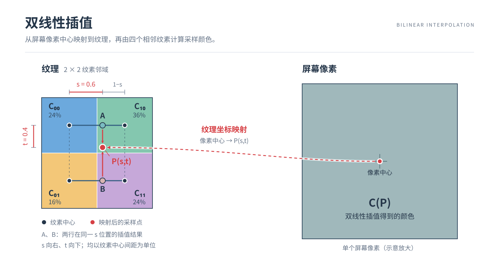
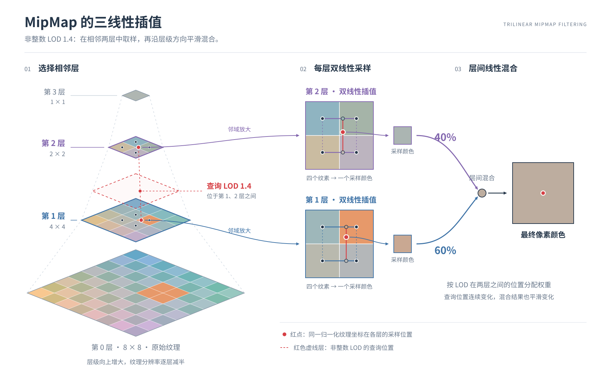

# Barycentric Coordinates 重心坐标

在一个二维三角形ABC内，某点$(x,y)$满足：
$$
    \alpha A+\beta B +\gamma C = (x,y)
$$
其中$\alpha + \beta + \gamma = 1$，则称$(\alpha,\beta,\gamma)$为该点的**重心坐标**
- 当$\alpha , \beta , \gamma \geq 0$时，则$(x,y)$在三角形内部
- 三角形重心的重心坐标：$(1/3,1/3,1/3)$

## 重心坐标插值

设$\triangle{ABC}$中$A,B,C$点各自有属性$V_1,V_2,V_3$，则三角形内某一点的属性：
$$
    V = \alpha V_1 +\beta V_2 +\gamma V_3
$$
其中$\alpha + \beta + \gamma = 1$，则称$(\alpha,\beta,\gamma)$为该点的**重心坐标** 
由于重心坐标不能保证投影后坐标不变，因此理论上重心坐标的插值必须在3维空间中插值。
但实际上，在投影后的2维三角形上进行重心坐标插值有许多好处
> GPU 在光栅化阶段主要需要回答两个问题：
> 1. 屏幕上的某个像素采样点是否位于三角形内？ => 重心坐标可解
> 2. 如果位于内部，应该如何插值该点的深度、颜色、纹理坐标等属性？

实际上，我们一样可以在2维进行重心坐标插值，只需要对2维的重心坐标作一个修正，就可以还原为3维的重心坐标。 
这就是**透视正确插值**

## 透视正确插值
设屏幕空间计算出的重心坐标为：
$$
    (\lambda_A,\lambda_B,\lambda_C)
$$
三个顶点在透视投影后的齐次坐标的$w$分量分别为
$$
    w_A,w_B,w_C
$$
则对应的透视修正为：
$$
    \beta_i = \frac{\lambda_i/w_i}{\lambda_A/w_A+\lambda_B/w_B+\lambda_C/w_C}
$$
这就是修正后的重心坐标，对应的就是三维空间中真正的重心坐标

# 纹理

- 纹理上某个点的$(u,v)$即是将像素的颜色设为对应纹理坐标的颜色
- texel 纹理上的像素

## 纹理过小

- 导致一个texel映射到多个pixel
- 解决方案：双线性插值

### 双线性插值

## 纹理过大

- 本质：屏幕像素相对于纹理的采样频率太低
  > 会导致“走样”问题
解决方案：
1. 抗锯齿（MSAA、DLSS）
2. MipMap

### MipMap

- 做范围查询
- 先预生成不同分辨率图，在像素映射纹素时查询。
- 生成MipMap时会不断像素除以2来获得新的像素图，直到不能再分。MipMap会分级，原先的纹理即为**第0级**
求MipMap Level D：
$$
    L = max(\sqrt{(\frac{du}{dx})^2+(\frac{dv}{dx})^2},\sqrt{(\frac{du}{dy})^2+(\frac{dv}{dy})^2})
$$
$$
    D = \log_{2}L
$$
举例：假设**1个像素**映射到**4个纹素**，这时候应该在$D=2$级的更粗糙的纹理图上找对应的像素（这个纹理图上的一个像素由**上一级**的相邻4个像素平均合并而成）

### 三线性插值

问题：当需要查询MipMap1.8层对应的纹素时，该怎么办？ 
解决：先在上下夹着的两层分别作双线性插值，再在层与层之间作一次线性插值

### 其他过滤方法
- RipMap 各向异性过滤：水平和竖直都分别压缩
- EWA Filtering