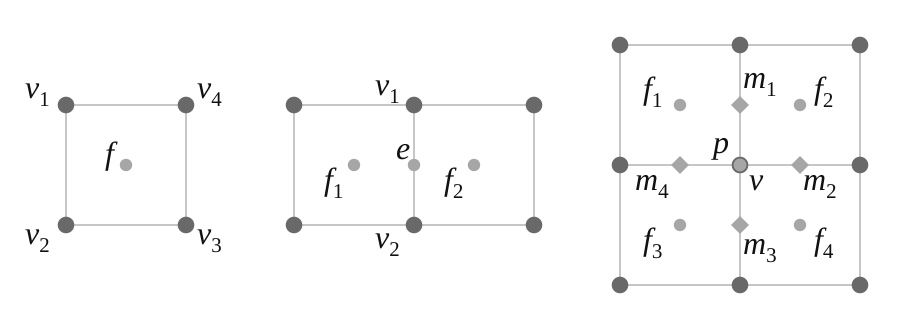

# 几何分类

根据需要选择对几何的表示方法

## Implicit geometry 隐式几何

- 点满足特定方程关系
> 例子：球上的点，即$x^2+y^2+z^2 = 1$是球的隐式表示
推广开来，即是点$(x,y,z)$满足关系$f(x,y,z) = 0$
- 优点：容易判断点和几何体表面的**关系**
- 缺点：难以**描述**构成这个几何体表面的点

### 数学公式表示

- 简单
- 难以表示复杂形状

### CSG 构造几何体几何

- 通过几何体间的布尔操作表示

### Signed Distance Functions 有符号距离函数

- 描述点到表面的距离

### Level Set Methods 水平集

- 类似于距离函数

### 分形

- 自相似，自己的一个部分和自己长得很像

## Explicit geometry 显式几何

- 点满足参数映射关系或直接给出点
> 例子：$f(u,v) = (\cos{u}\sin{v},\sin{u}\sin{v},\cos{v})$
- 优点：容易**描述**构成这个几何体表面的点
- 缺点：难以判断点和几何体表面的**关系**

### Point Cloud 点云

- 将几何体用一系列点表示
- 可以表示任何不同类型的几何

### Polygon Mesh 多边形面

- 将面拆成三角形或者四边形

# 曲线

## 贝塞尔曲线

- 用一系列**控制点**来定义曲线
- 曲线一定要经过**起始点**和**终止点**，且这两个点是曲线的切点

### 流程

### 公式
$\textbf{b}^n(t)$表示$t$时刻点的位置，$\textbf{b}_j$表示贝塞尔曲线的控制点
$$
    \textbf{b}^n(t) = \textbf{b}_0^n(t) = \sum_j^n\textbf{b}_jB_j^n(t)
$$
其中：
$$
    B_j^n(t) = \binom{n}{i}t^i(1-t)^{n-i}
$$
类似于二项式系数 
$t$在$[0,1]$对应的所有点即构成了这些控制点对应的贝塞尔曲线
> 贝塞尔曲线可以用二维点和三维点

### 性质

1. 曲线的起始点和终点一定分别是**第一个**控制点和**最后一个**控制点
2. 对于4个控制点的曲线（3阶），有：$b'(0) = 3(b_1-b_0)$，$b'(1) = 3(b_3-b_2)$
3. 控制点经过**仿射变换**后，新的控制点绘制出的贝塞尔曲线和直接将贝塞尔曲线上的所有点仿射变换后的新曲线完全一样
4. 凸包性质：贝塞尔曲线上的所有点一定在所有控制点构成的**凸包**内

### 分段贝塞尔曲线

逐段定义贝塞尔曲线 
3阶贝塞尔曲线分段最常用

### 曲线的连续性

- $C_0$连续：第一段的终止点就是第二段的起始点
- $C_1$连续：第一段的终止点的切线段和第二段的起始点的切线段共线且长度相等

## 其他曲线

1. splines 样条
> B-splines B样条，相当于贝塞尔曲线的扩展，有良好的局部性

# 曲面

## 贝塞尔曲面

- 本质就是在两个平面上分别应用贝塞尔曲线

# 几何处理

1. 网格细分
2. 网格简化
3. 网格正规

## 网格细分

### Loop 细分

1. 将三角形均分成4个
2. 将顶点分为**新**顶点和**老**顶点（新顶点就是均分三角形后出现的顶点）
3. 新顶点更新：将老顶点中与新顶点共线的点记为$A\quad B$，不共线的记为$C\quad D$，新顶点更新为：
$$
    \frac{3}{8}(A+B)+\frac{1}{8}(C+D)
$$
4. 老顶点更新：
$$
    (1-n\cdot u)original_position+u \cdot neighbor_position_sum
$$
其中$n$为老顶点的度，$u$为：
$$
    \left\{\begin{array}{rcl}
        3/16,&n=3 \\
        3/8n &
    \end{array} \right.
$$

### Catmull-Clark 细分

- 很多模型不是只由三角形构成的
- **quad face**：四边形面，**Non-quad face**：非四边形面
- **Extraordinary vertex** 奇异点：度不为4的点
细分流程： 
1. 每一条边取他的中点，每一个面也取他中间的一个点
2. 将边上的中点和面上的中点都**连接**起来
3. 面中点：
$$
    f = \frac{v_1+v_2+v_3+v_4}{4}
$$
边中点：
$$
    e = \frac{v_1+v_2+f_1+f_2}{4}
$$
旧顶点更新：
$$
    v = \frac{f_1+f_2+f_3+f_4+2(m_1+m_2+m_3+m_4)+4p}{16}
$$

性质：

1. 非四边形面在一次细分后会消失，同时增加对应非四边形面数量的奇异点

## 曲面简化

### Edge Collapse 边坍缩

二次误差度量：求新点到原本几个面距离平方和距离最小的新点
每一条边都有其最小二次误差，选取最小的边坍缩后更新与他关联的边的二次误差值

