# 前言：shadow mapping

- 点不在阴影里，如果摄像机能看到这个点，那么光源也能看到这个点
- 点光源对应硬阴影，体积光源对应软阴影

流程：
1. 第一次**光源**虚拟相机往场景看，记录深度，获得shadow map
2. **相机**实际渲染场景，投影回光源计算深度
3. 比较相机得到的深度和光源得到的深度是否**一致**，深度不一致就是阴影遮挡

局限：
1. 浮点数局限，数值精度问题
2. 光源虚拟相机**分辨率**问题
> 跟纹理处分辨率带来的问题类似

# 光栅化的优势和局限

- 速度快
- 全局问题的表现不好

光线定义：
1. 
2. 
3. 

光线追踪流程
1. 光线投射
从每个像素出发打出光线，打到场景上再将接触点和光源连接
2. 打到最近焦点后，将焦点和光源连线，看中间是否遮挡
3. 算着色，写回像素值

# Whitted-Style Ray Tracing

## 光线定义

- 光线沿直线传播
- 光线之间不会碰撞
- 光线从光源出发到达眼睛

## 光线追踪流程

1. 光线投射：从每个像素出发打出光线，打到场景上
2. 在场景的每个交点上都可以继续反射和折射
3. 每一个交点都算一次着色，将一束光弹射出的所有焦点和光源连接，将光看得到的点的颜色全部算到初始弹射点上
> primary ray：从像素开始打到**第一个**地方
> secondary rays：一次**弹射后**的光线
> shadow rays：从交点到光源的连线

## 交点计算

设起始点$o$和方向向量$d$，则光线在$t$时刻的位置：
$$
   R(t) = o + td
$$

### 隐式的表面求交

设表面方程为$f(p) = 0$，即是求：
$$
   f(o+td) = 0
$$

### 显式的表面求交

即是光线和三角形求交 
判断一个点是否在形状内外：
1. 从这个点出发发射一条射线
2. 射线与形状有**奇数**个交点，即是在内
3. **偶数**个交点，即是在外

交点计算：
使用**重心坐标**
设$(1-b_1-b_2,b_1,b_2)$是三角形面的**重心**坐标，求交点：
$$
   o+td = (1-b_1-b_2)p_0+b_1p_1+b_2p_2
$$
合理解：
1. $t\geq 0$
2. 重心坐标均大于0

## 加速计算：包围盒

光线和模型三角形频繁作运算效率很低 
因此用**包围盒**加速计算，光线在打入模型的包围盒前都**不考虑**进行相交计算 
常采用**AABB包围盒**（Axis-Aligned Bounding Box） 
将包围盒视为相对无限大**面**的交集，当光线与包围盒这些面交互时，有：
$$
   t_{enter} = max(t_{min})\quad t_{exit} = min(t_{max})
$$

tenter< texit 光线将要呆在盒子一段时间
texit >=0 tenter < 0 光线源在盒子

### 光线与AABB求交

1. 光线追踪前**预处理**，将包围盒分成多个格子
2. 格子与物体表面**相交**的格子标记
光线与盒子有交点-》检查盒子内是否有物体-》无物体，不与物体求交
-》有物体-》与物体求交点-》与物体不相交-》有物体-》与物体求交点-》与物体相交-》记录交点
算直线经过格子？
格子数量划分经验：格子数=c*objs，c约等于27在3d中

局限：场景分布不均均匀划分格子，导致太片空白地方划分无用格子

### 加速结构：空间划分

- cot-tree 八叉树：将三维空间分为8份，每份作为子节点还可以继续切
- kd-tree 维度无关，每次只分一次，且连续切分时从不同轴向切分
  > 因此这是一颗二叉树
- bsp-tree

kd-tree
按xyz轴方向划分
划分坐标：？
子节点
中间节点不存储三角形
只在叶子节点存储

kdtree流程：
和a相交-》和两个子节点1 b判定是否有交点
判定到叶节点则判断与其中所有元素是否有交点

### 加速结构：物体划分
Bounding Volume Hierarchy

包围盒-》将父包围盒物体分成两堆，求出其两堆各自新的包围盒，作为父包围盒的子节点。直到包围盒内物体足够少，叶节点只存储物体
划分有讲究。
划分方法：1.只沿着最长的轴划分 2.找中位数对象，使得三角形数量差不多，平衡-》三角形取重心，按个轴排序-》快速选择算法（top k）
判定流程：kdtree一样

# 辐射度量学
- 如何描述光照
- 给光不同的属性，基于几何光学，radiant flux，intensity，irradiance

## radiant energy
- 电磁辐射的能量

## radiant flux
- 单位时间的能量-功率W，lm lumen流明->光源有多亮
- 单位时间辐射出的光子更多

## 强度 intensity
- radiant intern
- dphi/dw，单位立体角的功率 坎德拉单位
- 立体角：单位球面上的面积/r^2
- 微分立体角
- 点光源均匀辐射：方向上对应光照强度I=phi/4pi

## 物体表面接收到多少能量irradiance
单位面积上接收到的power phi/A
面要和光线垂直
类比磁通量
球面传播

## radiance 

L（p，w） = dE/dwcostheta
costheta 光线入射角度

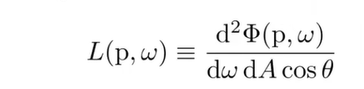
radiance和irradiance相比，多考虑方向（立体角）

irradiance和radiance：
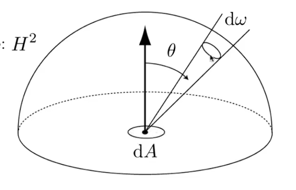
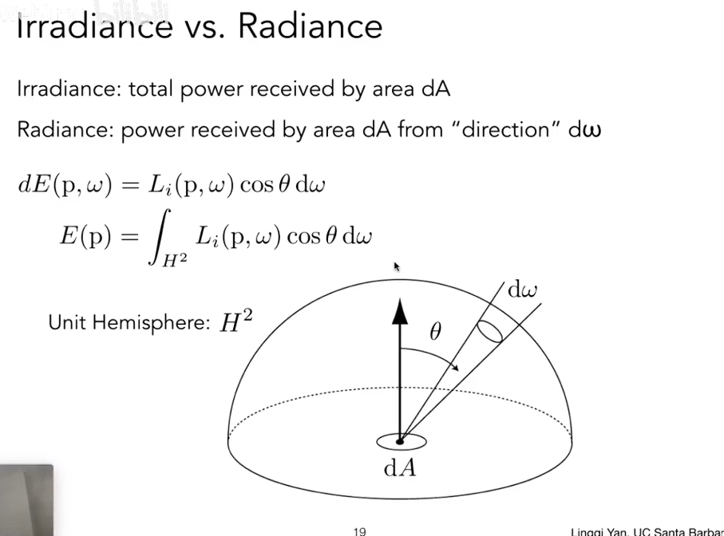

## BRDF 双向反射分布函数

### 反射
从某个方向来，到某个方向去->打到某个表面被吸收，然后表面辐射出去

定义函数：小面积A，从一个小立体角w接收到的irradiance 往四周辐射的分布
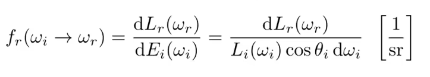

## 反射方程
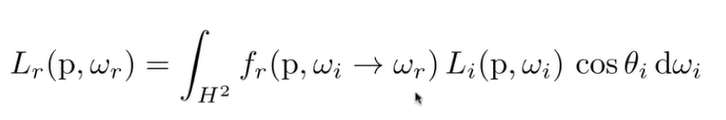

## 渲染方程
光线不止弹射一次，出射弹射几次后又弹回来入射
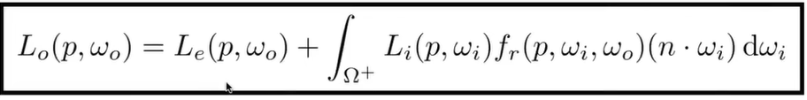
Ω+定义为半球面，前向为自发光
递归形式
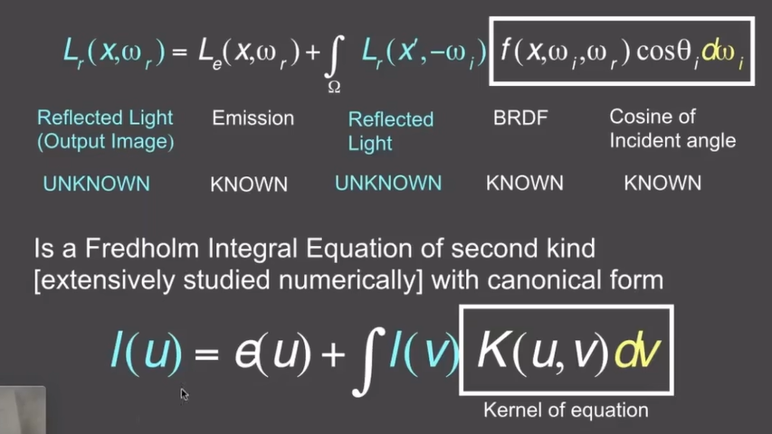
形式
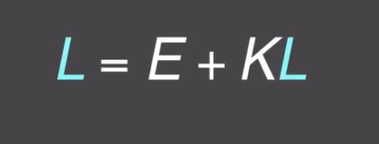
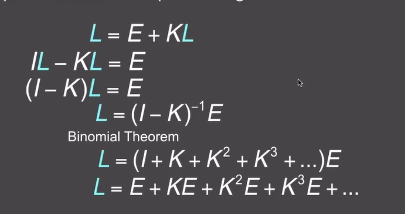
弹射一次 直接光照，弹射两次间接光照
## 全局光照

## 概率论回顾
随机变量
随机变量的分布
期望
概率分布函数

# 蒙特卡洛路径追踪

## 蒙特卡洛方法

解决问题：定积分，获得他的值
1. 随机取数，得到函数值，算对应a到b高度为函数值矩形面积
2. f（x）被积函数，p（x）概率密度函数随便取
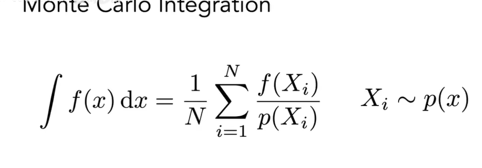
要求：
x上积分，采样x

# 路径追踪

## 直接光照

光直接从光源来打到点上

## 间接光照

光从物体反射过来 

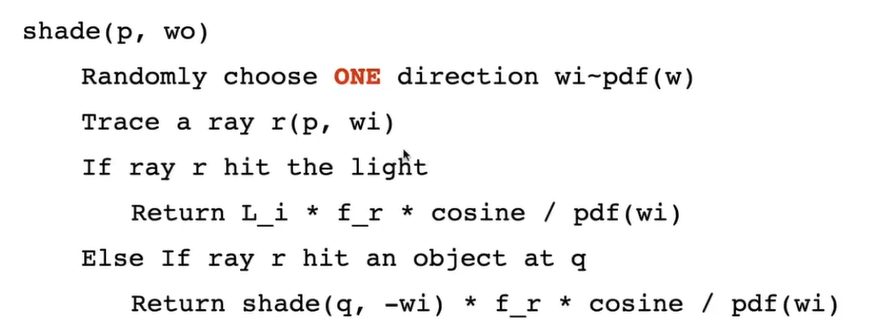
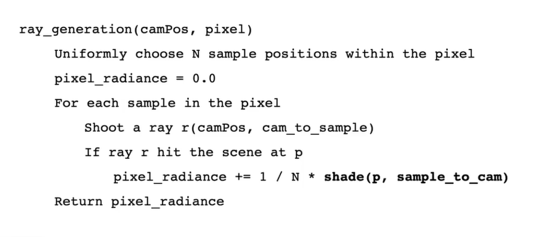

俄罗斯轮盘赌RR解决有限弹射次数能量损失的问题

先定概率p
p概率继续发射光线，1-p概率不发射光线，最后保证期望仍然是不变

问题：
1. 效率不高
   solution：在光源上进行采样
   -》渲染方程写成在光源上的积分
将光源面和点采样面进行映射
然后就变成对光源采样和积分
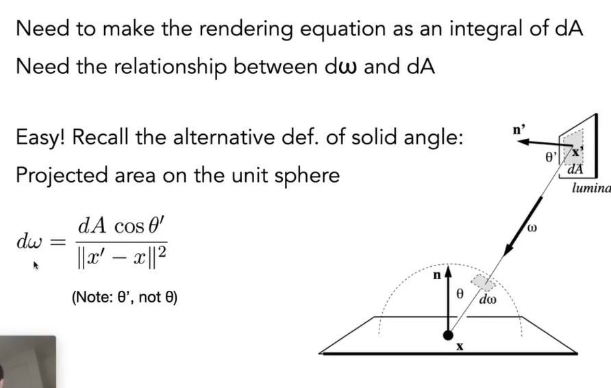
新流程：1.光源处通过光源采样，无RR
2.其他反射点有RR
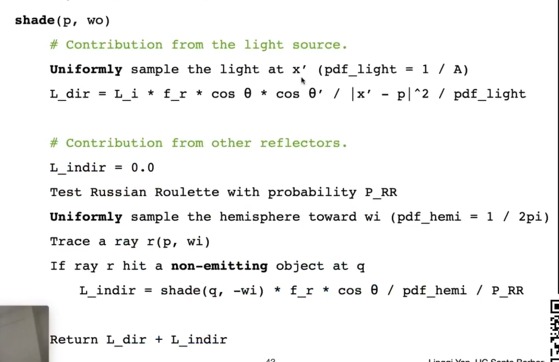

中间有物体？
加上判定，被挡了光判为0